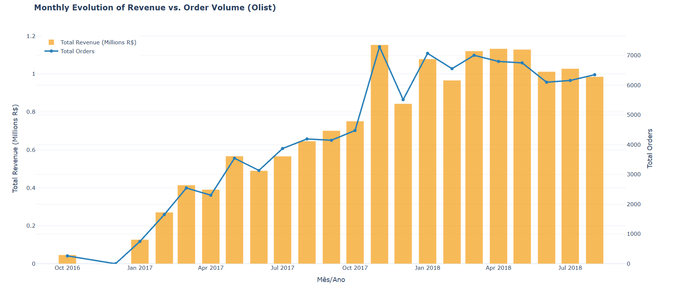
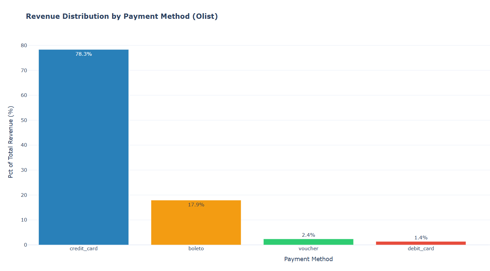
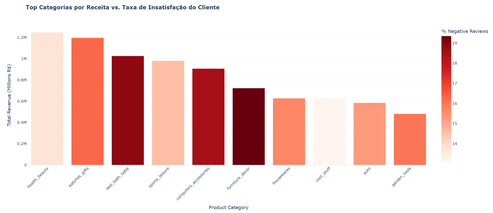
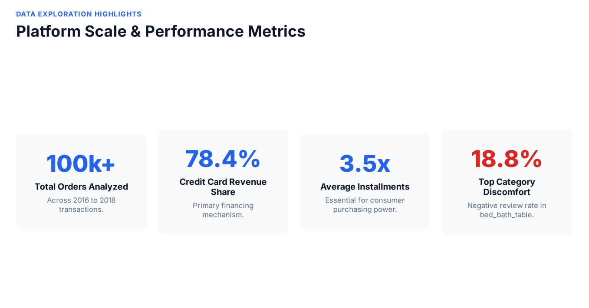
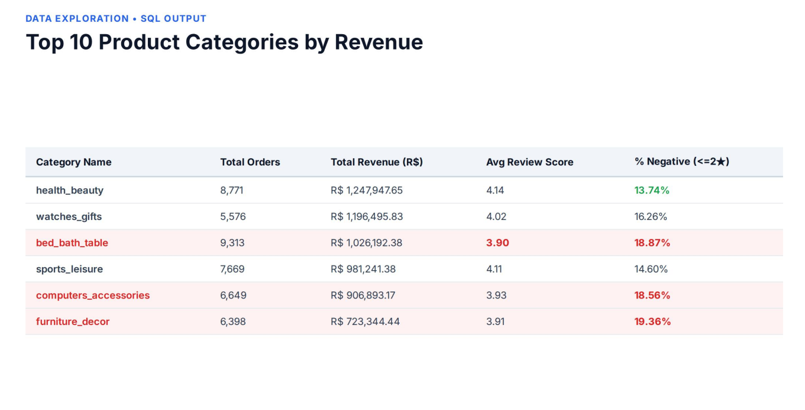

# Olist E-Commerce Data Analysis & Logistics Insights

> [Português] Análise relacional avançada de um marketplace de e-commerce real para identificar padrões de compras, hábitos de financiamento, impacto logístico na satisfação do cliente e mineração de texto em avaliações.
> 
> [English] Advanced relational analysis of a real e-commerce marketplace dataset to uncover purchasing patterns, financing habits, logistics impact on customer satisfaction, and review text mining.

---
> 🇵🇹 Devido ao tamanho do conjunto de dados, os ficheiros não estão incluídos neste repositório. O dataset pode ser descarregado em: https://www.kaggle.com/datasets/olistbr/brazilian-ecommerce
> 🇬🇧 Due to the dataset size, the data files are not included in this repository. You can download them from: https://www.kaggle.com/datasets/olistbr/brazilian-ecommerce
---

## Tools and technologies / Tecnologias Utilizadas
* **Languages & Data / Linguagens & Dados:** Python (Pandas, NumPy, Scikit-Learn), SQL (SQLite, Databricks).
* **Visualization / Visualização:** Matplotlib, Seaborn, Plotly (Interactive HTML Charts / Gráficos Interativos).
* **Advanced Techniques / Técnicas Avançadas:** CTEs, Window Functions, Custom Metrics Engineering (DDI, FES), NLP (TF-IDF).

---

## Key Findings & Visual Insights / Principais Descobertas & Visualizações

### 1. Vendas & Crescimento da Plataforma / Sales & Platform Growth

  

* **PT:** Crescimento acelerado até atingir o patamar de 1M R$ mensais após o pico da Black Friday em Novembro de 2017.
* **EN:** Accelerated growth reaching a stable ~1M R$ monthly baseline after the November 2017 Black Friday peak.

---

### 2. Hábitos de Pagamento / Payment Habits

  

* **PT:** O cartão de crédito domina com **78.4% da receita**, com uma média de **3.5 parcelas** por transação.
* **EN:** Credit cards dominate with **78.4% of revenue**, averaging **3.5 installments** per transaction.

---

### 3. O Paradoxo das Categorias (Receita vs. Insatisfação) / Category Paradox

  

* **PT:** Categorias de topo como `bed_bath_table` geram alta receita mas sofrem de taxas críticas de insatisfação (~18.9% reviews negativas).
* **EN:** Top categories like `bed_bath_table` generate high revenue but suffer from critical dissatisfaction rates (~18.9% negative reviews).

---

### 4. Apresentação & Métricas de Escala / Presentation & Scale Metrics

  
  

---

## Project Structure / Estrutura do Projeto
* `notebooks/`: Jupyter Notebook featuring data pipeline, SQL queries, and predictive modeling (`olist_ecommerceerd.ipynb`). / Notebook Jupyter com a pipeline de dados e consultas SQL.
* `outputs/`: Interactive HTML charts (`.html`) and exported visual assets (`.png`). / Gráficos interativos em HTML e recursos visuais exportados.
* `docs/`: Final academic report (`E-Commerce Analytics_ Olist Business Insights.pdf`) and presentation files. / Relatório académico final e ficheiros de apresentação.
* `data/`: Database structure and dataset references. / Estrutura da base de dados e referências do dataset.

---
*Project developed as part of Data Analytics & Business Intelligence studies.* / *Projeto desenvolvido no âmbito de Análise de Dados e Business Intelligence.*
